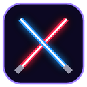
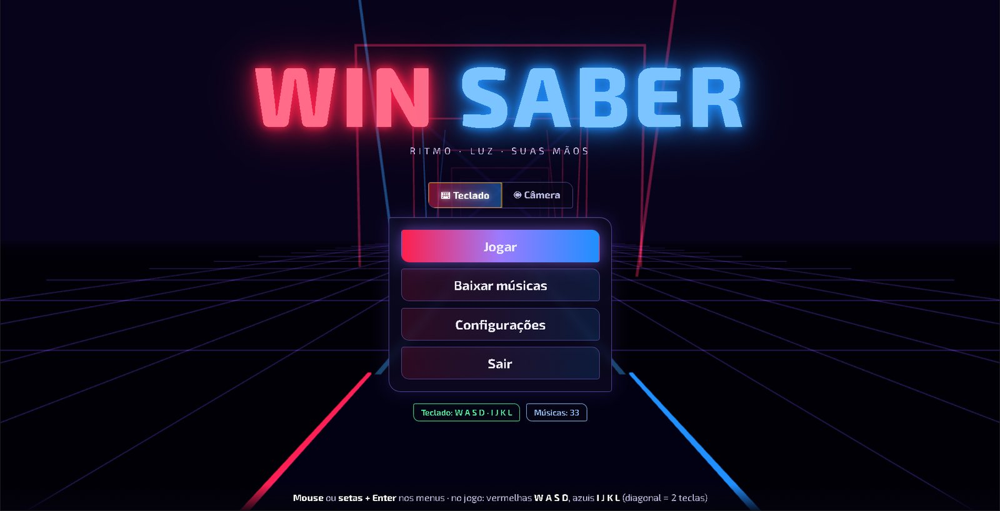
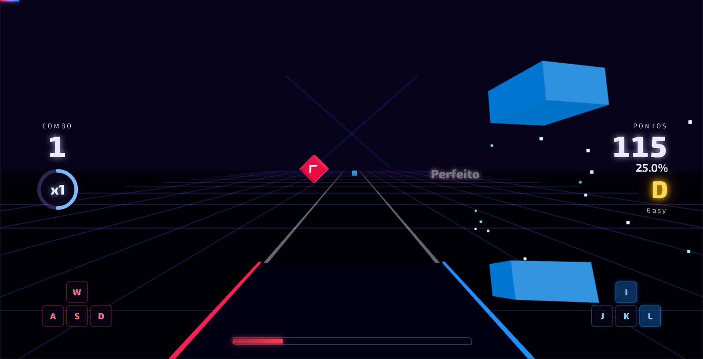
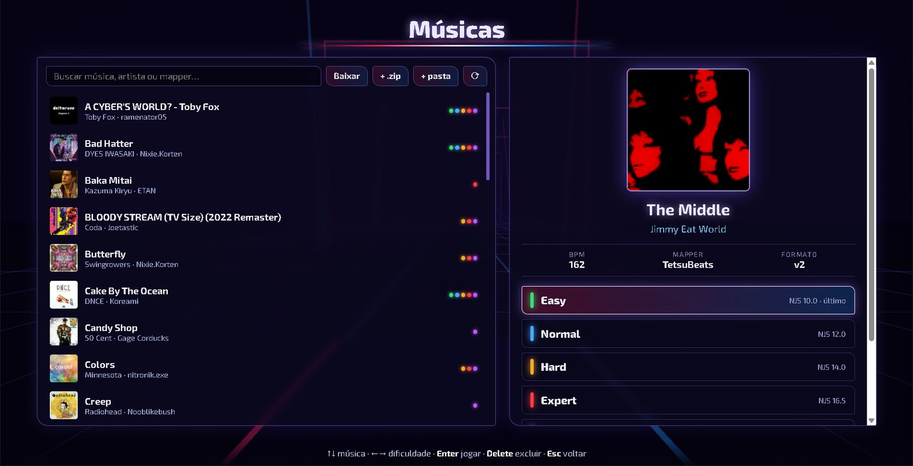
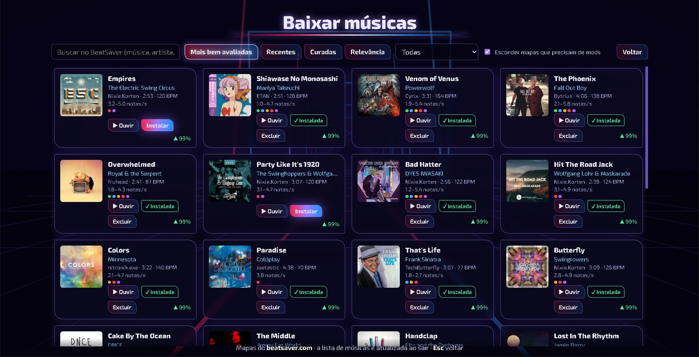

<p align="center">
  
</p>

<h1 align="center">Win Saber</h1>

<p align="center">
  <b>Jogo de ritmo neon para Windows.</b> Corte os cubos que voam na sua direção, no ritmo da música
  e na direção da seta — <b>no teclado</b> ou <b>com as mãos, pela webcam</b>.
</p>

<p align="center">
  <a href="../../releases/latest"><b>⬇ Baixar para Windows</b></a> ·
  <a href="#como-jogar">Como jogar</a> ·
  <a href="#compilar-a-partir-do-código">Compilar</a>
</p>



## O que é

Win Saber é um jogo de ritmo independente no gênero dos jogos de "cortar blocos com sabres":
os cubos vermelhos e azuis chegam pela pista no tempo da música e você precisa cortá-los
na direção indicada pela seta. Ele lê os **mapas feitos pela comunidade** no formato aberto
usado pelo [BeatSaver](https://beatsaver.com), então há milhares de músicas disponíveis —
e dá para baixá-las **de dentro do próprio jogo**.

Dois jeitos de jogar, escolhidos no menu:

| ⌨ **Teclado** | ◉ **Câmera** |
|---|---|
| Notas vermelhas em **W A S D**, azuis em **I J K L**. A tecla é a direção da seta; diagonal = duas teclas juntas. | A webcam acompanha suas duas mãos com um modelo de machine learning (offline). Mão esquerda = sabre vermelho, direita = sabre azul. |



## Destaques

* **Baixar músicas no app** — busca no BeatSaver (mais bem avaliadas, recentes, curadas ou por nome),
  filtro por **dificuldade** (notas por segundo), prévia de áudio e instalação em um clique.
* **Mapas da comunidade sem conversão** — `Info.dat` v2/v4, dificuldades v2/v3/v4, mudanças de BPM,
  correntes, bombas, paredes e eventos de luz (a pista pisca no ritmo de cada mapa).
* **Pontuação completa** — combo, multiplicador ×8, energia, ranks SS–E; no teclado cada nota vale
  pela precisão (**Perfeito / Ótimo / Bom**), na câmera pelo movimento do corte.
* **Visual neon** com pista 3D, brilho, faíscas e cubos que se partem ao meio — com um modo
  *Desempenho* leve para notebooks.
* **Rastreamento de mãos com pouco atraso** — roda numa thread separada, escolhe sozinho o mais rápido
  entre GPU e CPU, e o sabre segue a trajetória prevista da mão para esconder o atraso da câmera.
* Importação de `.zip` e de pastas `CustomLevels`, prévia instantânea das músicas, tela cheia (F11).

| Músicas | Baixar músicas |
|---|---|
|  |  |

## Instalação

1. Baixe a versão mais recente em **[Releases](../../releases/latest)**:
   * `WinSaber-Setup-x.y.z.exe` — instalador (cria atalho na área de trabalho);
   * `WinSaber-Portable-x.y.z.exe` — versão portátil, roda sem instalar.
2. O Windows pode avisar que o aplicativo não é reconhecido (ele não tem assinatura digital):
   clique em **Mais informações → Executar assim mesmo**.

Requisitos: Windows 10/11 64 bits. Para o modo câmera, uma webcam (de preferência 60 fps) e boa iluminação.

## Como jogar

1. No menu, escolha **⌨ Teclado** ou **◉ Câmera**.
2. **Baixar músicas** → instale algumas (comece pelo filtro *Leve* ou *Média*).
3. **Jogar** → escolha a música e a dificuldade → **Enter**.

**Teclado**

| Nota | Tecla |
|---|---|
| seta reta (↑ ← ↓ →) | a direção, na mão da cor: **W A S D** (vermelhas) ou **I J K L** (azuis) |
| seta diagonal (↗ ↖ ↘ ↙) | as duas teclas juntas (ex.: **W+D** = ↗). Com *Diagonais fáceis* ligado, uma delas basta |
| ponto (sem seta) | qualquer tecla daquela mão |
| corrente | acerte a cabeça e **segure** a tecla |
| bomba | não aperte teclas daquela mão sem nota bem na hora |

**Câmera** — em *Configurações → Câmera e calibração*, fique a 1,5–2 m da webcam com o tronco e
as mãos visíveis, abra os braços na altura do peito e aperte **C**. No jogo, faça o movimento de
corte na direção da seta.

**Atalhos:** **Esc/Espaço** pausa · **Enter** encerra após a última nota · **F11** tela cheia ·
**Delete** exclui a música selecionada (vai para a Lixeira).

**Dicas:** se os acertos parecerem sempre adiantados ou atrasados, ajuste o *Offset de áudio*
(fones Bluetooth costumam precisar de ~150 ms). Para aprender, ligue *No Fail*. No modo câmera,
uma webcam de 60 fps e uma luz de frente para você fazem muita diferença.

## Compilar a partir do código

Requer [Node.js](https://nodejs.org) 20+ (e Python 3 só para os testes).

```bash
npm install          # dependências + modelo de mãos e runtime WASM (baixados uma vez)
npm start            # compila e abre o jogo
npm run dev          # desenvolvimento com recarga automática
npm test             # testes do núcleo (leitura de mapas, juízes da câmera e do teclado)
npm run dist         # gera o instalador e a versão portátil em release/
```

```
electron/            processo principal: janela, webcam, biblioteca, BeatSaver, configurações
src/core/            núcleo testado: leitura de mapas, juiz de cortes (câmera), juiz do teclado, pontuação
src/game/            cena 3D (Three.js) e gameplay/HUD
src/tracking*.ts     câmera + MediaPipe Hand Landmarker (worker) + filtro e previsão do movimento
src/keyboard.ts      entrada do modo teclado
src/ui.ts            telas: menu, músicas, baixar músicas, configurações, calibração, resultados
tests/               testes (vitest) com robôs que "jogam" os mapas
tools/               bs2wbs.py (leitor de mapas de referência), make_demo_song.py, make_icon.py
```

Feito com [Electron](https://www.electronjs.org), [Three.js](https://threejs.org),
[MediaPipe](https://developers.google.com/mediapipe) e TypeScript.

## Créditos e licenças

* Fonte **Exo 2** — SIL Open Font License 1.1 (`public/fonts/OFL.txt`).
* Modelo de mãos **MediaPipe Hand Landmarker** — Apache 2.0 (Google).
* Mapas e músicas pertencem aos seus autores e são baixados diretamente do
  [BeatSaver](https://beatsaver.com); use apenas os que você tem direito de usar.

Win Saber é um projeto independente de fãs do gênero e **não é afiliado, associado nem
endossado** por nenhum jogo ou empresa comercial.
